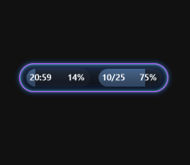
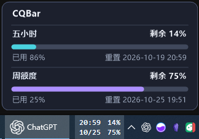
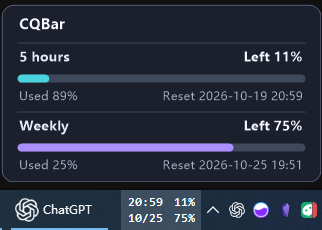
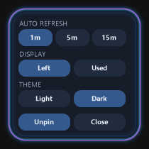

# CQBar - Codex Quota Bar 重置吧！

[English](README.md) | [简体中文](README.zh-CN.md)

在 Windows 桌面上轻松查看当前 Codex 账号的额度与重置时间。

## 功能
- 显示 Codex 当前账号的 5 小时和每周额度、使用比例与重置时间。
- 支持手动和自动刷新及本地偏好；胶囊态指标可切换使用比例与重置时间，托盘可切换显示形态、置顶状态和界面语言。
- Windows 10 x64 可选用任务栏工具栏；Windows 11 可使用悬浮窗。
- Windows 10 任务栏悬停卡片显示五小时和周额度的剩余进度、已用比例与重置时间。
- 一个安装包提供简体中文和英文界面。

## 运行要求
- 需要 Windows 本机已有 Codex 登录；程序从当前用户的 .codex/auth.json 读取登录状态。
- 认证令牌不会显示在界面或写入应用设置。

## 安装
- 从下方最新版本页面下载 Windows x64 安装程序并运行；安装需要管理员权限。

## 界面预览

### 紧凑显示

紧凑显示提供悬浮窗和任务栏两种形态。任务栏形态支持 Windows 10 x64。

<table>
  <thead>
    <tr><th>悬浮窗紧凑显示</th><th>任务栏紧凑显示</th></tr>
  </thead>
  <tbody>
    <tr>
      <td align="center"></td>
      <td align="center"></td>
    </tr>
  </tbody>
</table>

### 悬停查看额度详情

将鼠标悬停在任务栏额度上，可查看剩余比例、已用比例和重置时间。

<table>
  <thead>
    <tr><th>简体中文</th><th>English</th></tr>
  </thead>
  <tbody>
    <tr>
      <td align="center"></td>
      <td align="center"></td>
    </tr>
  </tbody>
</table>

### 悬浮窗设置

设置面板可调整自动刷新间隔、显示方式、主题，以及任务栏固定状态。

## 从源码运行

需要 Windows、Node.js、Rust MSVC 工具链、Visual Studio C++ x64 构建工具和 Windows SDK。

开发运行：

~~~powershell
npm ci
npm run tauri:dev
~~~

构建 Windows x64 安装包：

~~~powershell
npm run release
~~~

安装包和 SHA-256 校验文件会生成在 release/。安装 DeskBand 需要管理员权限。发布脚本只在本地构建，不会自动上传安装包。

## 许可证

MIT 许可证，详见 [LICENSE](LICENSE)。

## 发布与下载
- [本版本发布说明](docs/releases/v0.1.0.zh-CN.md)
- [下载最新版本](https://github.com/mrshuangok/CQBar/releases/latest)
